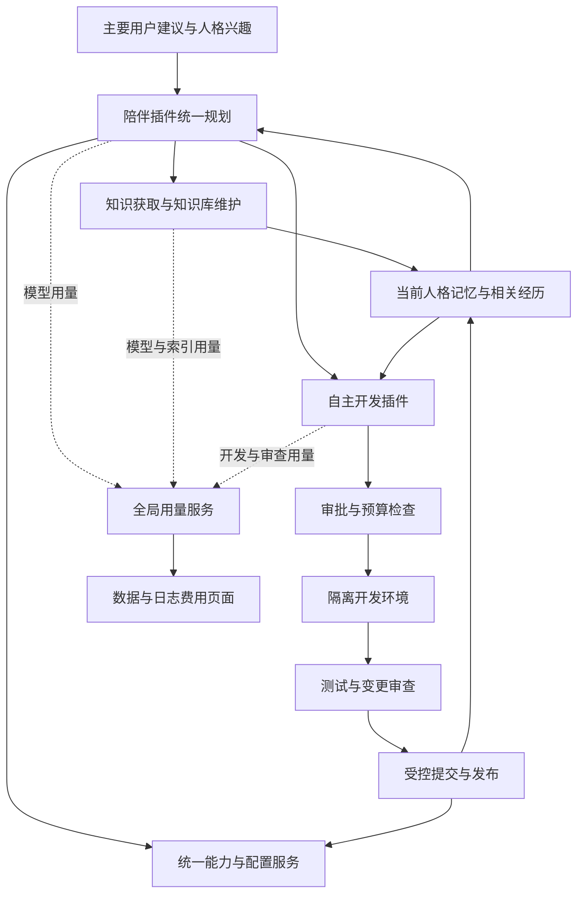

# 小小情自主开发与知识成长方案书

确认日期：2026-11-03，北京时间。版本：需求基线 1.0。

本方案规定小小情如何自主调整配置、拓展代码能力、维护知识库，以及如何统一审批、费用和执行结果。目标是让她持续获取感兴趣的信息，改善与主要用户的互动和陪伴。开发顺序与验收见[开发计划书](autonomous-evolution-development-plan.md)。

本文中的要求用于后续开发，不表示新功能已上线。本次交付限于文档；不修改运行权限、服务、配置和账户授权。

## 1 目标与已经确认的约定

| 项目 | 约定 |
| --- | --- |
| 唯一自主开发 Bot | 小小情，QQ 2893214983，QQ 平台标识 xiaoxiaoqing，并核验绑定的人格身份 |
| 审批人 | 小小情的主要用户 1005145948；通过已验证的 QQ 私聊或已配对桌宠确认 |
| 初小晴 | QQ 2510093206，主要用户 1207862759；不获得自主开发权限，保持自己的日常能力和数据隔离 |
| 源码范围 | /home/yingjxu/workspace/astrbot-snowluma，包括其中的 Coopanion 客户端子仓库 |
| 调度 | 陪伴插件统一安排，自主开发插件执行；沿用全天计划与动态调整 |
| 依赖 | 自主开发必须依赖已启用、接口兼容且当前人格可用的陪伴与记忆插件 |
| 开发审批 | 关闭、每次修改前询问、自动审批但重大修改询问，共三种模式 |
| 配置自调 | 独立授权，与开发模式分别控制；保留此前明确给予小小情的配置调整授权 |
| 开发模型 | 方案设计和代码开发默认 GPT-6.1 Sol，effort 为 high，支持分别调整 |
| 知识库维护 | 放入陪伴面板的自主活动与拓展，使用 AstrBot 知识库接口 |
| 费用界面 | 放入 AstrBot 数据与日志，覆盖两个 Bot 与所有模型调用 |
| 月度额度 | 提供 2500 美元的可配置基准；额度来源、账期和账户真实余额另行核实 |
| 客户端 | Windows；业务通信继续使用 WSS，不引入第二套客户端人格、记忆或自主模型 |

权限以 Bot 账号、平台和已验证人格绑定共同判断，名称只是展示信息。切换面板人格、复制配置、重命名、恢复备份或插件重载，都不能产生第二个自主开发主 Bot。普通聊天用户、初小晴及其主要用户不能提交开发命令或批准开发任务。

## 2 当前基础与接入方式

现有陪伴插件具备真实日程、人工计划与动态调整、活动账本、扩展能力发现、任务断点、执行回执和部分 Token 统计；记忆、表情管理和桌宠已经接入扩展活动。功能自知提供当前会话可用工具与状态。新方案复用这些基础，不增加另一套竞争的日程调度器。

当前自主活动名单允许记忆整理、表情图片处理和桌宠活动。名单授权的是已有适配活动，不授予安装插件、修改代码或修改自身权限。关闭自主开发不能停掉这些已授权的日常活动。

2026-11-03 核对时，AstrBot 知识库数据库中尚无知识库，陪伴所选知识源为空。知识库阅读开关已开不代表有可读资料。当前配置工具主要要求管理员当条消息明确提出修改；角色贴合自动调参也只有预设范围，尚未实现本方案的通用自主配置调整。

陪伴目录已有 B 站视频阅读与资料柜的接口声明；开发时先探测是否缺插件、后端、登录或连接，再决定复用、补接或新建能力。

部分陪伴、记忆、表情运行源码位于被 Git 排除的 data 或 runtime 目录。自主开发上线前，必须整理出受控源码或可重现补丁，私有数据继续排除。Git 检出不能代替数据备份。

## 3 组件职责

| 组件 | 职责与边界 |
| --- | --- |
| 陪伴插件 | 根据兴趣、关系、日程和可用能力产生目标，决定是否推进及何时分享；统筹自主活动 |
| 记忆插件 | 提供相关偏好和共同经历，记录真实成果，保持用户、人格和可见范围隔离 |
| 自主开发插件 | 任务管理、方案设计、代码变更、测试、审批协作、提交及发布请求；初拟注册名 astrbot_plugin_autonomous_development |
| 统一能力与配置服务 | 复用现有扩展注册、功能自知和人格配置接口，提供一致状态与唯一配置写入流程 |
| 开发执行器 | 在项目隔离环境运行工程工具，不持有主机管理员权限或可读取的发布凭据 |
| 发布与恢复入口 | 独立验证授权、版本、产物和检查结果，执行部署及恢复；不依赖待更新插件正常运行 |
| 全局用量服务 | 统一归属、去重、计价、额度预占和对账；自主开发关闭后仍运行 |
| 桌宠插件 | 配对、终端状态、来源与目标路由、能力调用及原生授权，不替代上述治理 |

审批器和发布入口执行用户策略。开发器修改审批器、发布器或自身权限相关源码时，必须先走重大变更流程；修改后的规则不得在当前任务中自行生效。网页和插件文档没有修改这些策略的权限。

## 4 自主配置调整与开发权限

### 4.1 两项独立设置

“允许自主调整自身配置”控制小小情对已授权字段的调整。“自主开发审批模式”控制代码开发、插件安装与工程变更。关闭开发不撤销配置自调授权；配置自调不授予代码开发或第三方账户权限。

迁移时逐项记录用户此前明确给出的授权。当前旧实现开关关闭是运行事实，不能直接当作用户撤销授权，也不能把对话中的授权说成代码已经实现。上线时应展示迁移后的范围与实际生效状态。

### 4.2 统一配置写入

聊天修改、自主调参、角色贴合调节、管理面板和开发后的配置迁移，接入同一套校验和变更记录。不同插件通过适配器登记可以调整的字段、类型、范围、所属人格、依赖和生效方式。

每次写入需要校验当前值与读取时的版本，保存修改前后值、理由、发起来源、实际生效结果和撤销信息。存储成功但运行值被主动强度预设等机制覆盖时，必须显示覆盖后的有效值，不能声称频率已经改变。

你可以锁定配置值；锁定项及明确约定的约束优先于自主调节。发生人工修改后，旧任务应重新评估，不能把旧值覆盖回去。自动调节设观察期、调整幅度和冷却，避免频繁来回变化。

当前人格继承的配置应显示实际影响范围。小小情不能直接调整会改变初小晴行为的共享值；先处理继承关系，或按重大修改审批。自主配置入口使用已验证的任务身份，不伪造管理员私聊或绕过原工具的明确指令检查。

### 4.3 审批模式

| 模式 | 行为 |
| --- | --- |
| 关闭 | 不启动开发执行或开发专用模型请求；可保留正常陪伴中记录的兴趣目标；其他已授权日常活动继续运行 |
| 每次修改前询问 | 允许只读调研与生成变更草案，给出目标、文件范围、影响、预计费用和验证方式；批准后才写任务工作区 |
| 自动审批但重大修改询问 | 在已登记范围内自动审查普通开发、测试和配置变更；重大修改等待你确认 |

“每次修改”指一项完整变更任务，不按每行或每个文件反复询问。此前已明确授权的日常配置微调按独立配置权限执行，不因开发模式变成每次询问。超出授权字段或影响范围时进入审批流程。

### 4.4 重大修改与审批有效性

以下属于重大修改：账号与主要用户绑定、管理员与设备认证、OAuth、消息入口和路由、记忆持久化或隔离、审批与预算边界、公共核心代码、数据迁移或删除、显著依赖升级，以及有中断风险的生产更新和正式 Windows 发布。

审批请求关联任务、变更版本摘要、影响范围、费用上限、有效期及允许的操作阶段。批准开发不自动批准随后扩大范围的部署。你可撤销未执行的批准；任务变更、设备撤销、身份变化或审批过期时重新校验。等待超时不视为同意。

确认只来自已验证的主要用户私聊或配对终端，不接受引用消息、群成员、网页文本或模型转述。询问和进展说明由当前人格生成；面板状态标签与审计字段采用明确、稳定的系统文本。

## 5 开发环境与仓库边界

固定主机项目根为 /home/yingjxu/workspace/astrbot-snowluma。工程执行器使用受限开发副本，只提供所需项目源码的写权限。主机其他 workspace、系统目录、SSH 登录数据、通用容器管理入口和主机管理员权限均不提供给执行器。

路径校验覆盖绝对路径、相对路径、符号链接、子模块、Git 工作区和子进程。仅设置 cwd 不能满足隔离要求。缓存、临时文件和构建输出留在项目任务目录或隔离环境内，不写主机其他目录。

生产聊天、记忆数据库、QQ 登录态、密钥、令牌、私有媒体和实际环境配置通过受控接口使用，不能因位于项目根内就任意读取、修改或提交。相关经历以最小必要上下文提供给开发模型。开发环境和测试日志也执行敏感信息过滤。

Git 目标限定为父仓库 AstrBot_snowluma_for_zzz 与客户端 Coopanion。源码工作分支与生产运行目录分离；父仓库固定已验证的客户端提交。推送凭据由受控发布入口使用，不直接暴露给模型或任意命令。

每项任务从明确的提交基线开始，记录两个仓库状态。发现未归属的人工修改、基线漂移、未完成发布或迁移时暂停，不自动覆盖。禁止强制推送、改写他人历史或直接更新 main。开启相应模式并登记推送目标后，普通任务可自动提交并上传指定任务分支；合并、部署和 Releases 按各自授权执行。

## 6 开发任务与资源调度

目标可以来自你的建议、她的兴趣、失败活动、使用反馈或已确认的缺失能力。首先判断已有能力是否够用、修复配置或适配器是否更合适，以及收益能否覆盖开发成本。相似目标合并，避免重复造插件或反复开启已完成话题。

标准流程为：目标形成、只读调研、方案与审批、隔离实现、测试审查、提交上传、部署审批、发布核验、登记能力、实际使用与回顾。各阶段分别记录，不能把提交代码写成已经部署或已经使用。

任务状态至少包含待评估、待批准、待执行、执行中、暂停、验证中、待发布、已发布、已完成、失败、已取消、已回滚和结果待核实。每个阶段保留版本、断点、费用及证据，重启或重载后恢复；非幂等外部操作结果未知时先核实，不能直接重发。

开发由陪伴日程安排，保持全天计划与动态调整。一个项目同时最多一个自主修改或发布任务；人工维护、插件升级和自主发布使用共同互斥机制。只读探索可按资源设置并发，不能争抢同一配置或生产会话锁。

正常聊天优先。可中断任务保存断点后暂停；模型请求和工程命令设取消、超时与资源限制。独立提醒、原始消息捕获、记忆保存、OAuth 刷新和空间关注监听继续按既有规则运行。长任务交由后台执行器，日程适配器以短步骤提交和查询，不长时间占用聊天线程。

排期、执行记录、审批有效期与费用日切使用一致的校准时间和明确时区；锁租约、超时和退避使用适合计时的单调时钟。动态延期不能把未来安排提前执行。发现校准时间异常时保留任务并报告，不授予开发器修改主机系统时间的权限。

设置每任务与每日费用、运行时长、失败次数和最大自修复轮次。超限后暂停或失败，不能为了修复失败自动提高额度。后台工作与对用户的打扰分别控制；免打扰时按配置继续允许的后台工作，审批和分享保留待处理。

## 7 开发模型与认证

设计和开发默认 gpt-6.1-sol，reasoning effort 为 high。可分别选择设计、开发和审查模型，并只显示实际提供商支持的 effort。普通聊天继续使用原模型；不得为开发修改全局默认聊天模型。

模型通过 AstrBot 已有提供商调用，OAuth 由现有插件独占刷新。不另启旧 HAPI、cc-connect 或共享刷新凭据的第二个登录进程。工程工具运行与模型推理分别管理；工程执行器不继承主机全部权限。

模型不可用时明确暂停，或按用户预先配置的备用模型执行，并记录实际模型；不得悄悄替换模型。调研、审查、重试和压缩上下文等模型请求全部进入用量账本。

## 8 统一能力发现与插件市场

复用陪伴扩展注册、真实日程适配、功能自知和桌宠目录，形成一致的能力视图。能力记录实现版本、来源插件、适用 Bot 与人格、已开启状态、授权状态、依赖、在线条件、执行影响、费用归属、最近成功结果和不可用原因。

“允许自主执行的扩展活动”继续作为后台授权机制，由可读的能力列表管理，迁移旧完整标识；兼容既有记忆整理、表情处理和桌宠活动。关闭开发不能让这些队列停止或丢失。

新插件先在隔离环境核查来源、版本、依赖、启动行为和权限，完成兼容测试后安装。读取 Skill 说明不等于执行 Skill；安装插件不等于允许其全部后台动作。代码开发可以补充缺失适配器，但每项能力仍要声明实际执行边界。

交付需包含功能入口、配置说明、工具与活动登记、可用性探测、持久回执、费用记录及回滚方式。上游升级必须识别当前补丁、版本和哈希，不能覆盖仓库维护的本地修复。

## 9 知识库与信息来源

在陪伴面板的自主活动与拓展增加自主维护知识库、可读库与可写库、关注主题、来源、频率、费用和每日写入量设置。无知识库时显示原因并提供创建入口；首个可使用小小情学习库。初小晴资料单独保存，公共资料的共享需明确选择。

处理流程为：发现候选资料、取得正文或可验证内容、评估价值、保存来源和时间、去重与版本比较、写入知识库、等待索引、检索回查、记录学习成果。使用 AstrBot 的知识库管理接口，避免直接修改其数据库。

知识库需单独核验向量化模型，必要时核验重排模型及单价。聊天 OAuth 可用不代表提供 Embedding 服务；缺少索引模型时显示依赖未就绪，不能把仅保存原文报告为完整入库可检索。新增模型服务的费用纳入全局预算。

来源 URL、作者或发布者、发布时间、抓取时间、正文摘要、内容哈希、适用人格、隐私级别、更新或过期状态应可追溯。按来源与内容去重，保留更正和旧版本关系；过期资料先标记或归档，批量删除与不可逆清理按重大修改处理。

知识库内容是资料，不成为工具授权或自动执行指令。私人聊天、QQ 空间的私有信息、公开网页与工程日志按不同可见范围保存，不默认混入共享库。读取到的视频标题、简介、字幕和实际视频内容分别标记，不能都声称看过完整视频。

记忆记录相关偏好、共同经历和关注动机；知识库保存可检索资料；表情认知保存图片 ID、人物、文字、情绪、含义、确认状态和版本。人物更正和 GIF 语义沿已有流程更新，暂存不算入库，重复图不重复收录。

入库、索引成功、可被检索和模型本身掌握知识是不同状态。日记只使用真实读取、保存、执行和交流证据，避免把开发日志堆进共同经历或把网页故事写成自己的亲身经历。

## 10 平台账号与桌宠行为

开发权限与实际对外操作权限分别校验。小小情可开发 B 站功能，登录由用户提供或完成；只能使用明确绑定给她的账号。阅读、点赞、评论、关注和发布分别配置，保留频率、目标和去重约束。开发成功不自动获得公开发言权限。

QQ 空间继续使用各自 SnowLuma 原生接口，不依赖浏览器。空间关注监听、收件箱和自主浏览共用去重与实际结果，不能把浏览成功当成点赞成功。初小晴的账号、凭据和记忆不能被小小情继承。

Windows 上的键鼠、屏幕、麦克风等继续遵守客户端本地授权、锁屏、休眠、撤销和断线规则。服务端开发审批不能代替客户端原生授权。客户端扩展必须提供兼容能力和真实回执，不能仅凭扩展名称推断已经支持。

### 10.1 已确认的主动交流路由

| 当前情况 | 新主动交流 |
| --- | --- |
| 已验证连接可达，桌宠身体可见，屏幕与会话可交互 | 优先桌宠，抑制同一交流对应的 QQ 主动消息和 QQ 戳一戳 |
| 隐藏桌宠小人，或身体不存在 | 改选 QQ，仍受主动消息开关、间隔和配额限制 |
| 断网、心跳过期、退出、锁屏、休眠或熄屏 | 改选 QQ |
| 用户明确开启手动免打扰 | 等待，不改道 QQ 打扰 |
| 只关闭聊天窗口，小人仍可见且可交互 | 保持桌宠优先 |
| 已提交桌宠但投递结果未知 | 核实旧结果，不跨端重发 |

这些规则针对新主动交流。普通被动回复保持原输入端；表情等媒体沿当前事件发送，桌宠发送失败不自行转发 QQ。审批请求沿可用通知渠道递交，但原审批身份和任务版本不变。

隐藏与免打扰必须在 UI 中有不同名称和说明。程序不能仅凭窗口被其他程序遮挡推断用户正在看屏幕；以已知的终端状态判断。

## 11 费用账本与额度控制

### 11.1 全局记录与归属

在模型请求提交和实际用量返回处统一记录，覆盖普通聊天、陪伴规划、记忆整理、识图、表情处理、自主开发、自动审查、知识向量化与其他模型服务。插件直接调用提供商时也须进入同一入口，不能只统计普通聊天钩子。

每条物理请求记录请求与重试标识、上级任务、发起插件与功能、Bot 与人格、提供商、实际模型、effort、开始结束时间、成功或失败、输入、缓存、输出及推理用量、价格版本、费用和统计可信度。

一次请求只计一次，按发起方归属；参与注入上下文的其他插件可作辅助标签，不重复分摊整笔费用。每次实际重试独立计量。推理与缓存字段按提供商口径处理，不重复叠加输出或缓存输入。

缺失实际用量时保留待结算或估算标记，不填成已知零费用。历史无法归属的数据展示为历史未归属。费用保留精确货币计算与价格生效版本，账本不保存完整提示词和私人聊天正文。

### 11.2 预算与真实账户额度

全局月度上限以 2500 美元为可配置基准，两个 Bot 共用该总额，并可设置 Bot、插件、功能、每日和单任务子上限。实际额度来源、结算周期、重置时间及账户是否供其他应用共用，是上线前的待确认项。

请求前预占预计额度，完成后按实际结算；并发请求不能各自看到相同余额而重复花费。为正常聊天预留预算，在临近上限时先暂停自主开发和其他非必要活动。达到总硬上限后停止新的付费请求，保留日志、原始数据和已有回执处理。预算降低、价格缺失和在途调用分别处理，不能承诺在无法核实账户计费时得到绝对精确的账户硬上限。

分别展示项目预算余额、账户报告额度和在途预占。OAuth 用量窗口或 credits 字段不能未经核实就换算为美元余额。账户还供其他应用使用时，区分账户总消耗和本项目消耗。账户接口异常时显示最后成功更新时间与未知状态，不自行补造余额。

账本按北京时间提供日统计，月账期按实际配置显示。每个请求结算后更新本地页面；账户侧数据可能延迟，应单独标明时间。阈值、告警方式和每日开发预算由配置决定，不能由自主开发提高。

## 12 管理界面

陪伴面板的自主活动与拓展提供能力清单、自主配置权限、知识库维护和进入自主开发的入口。新插件提供目标、任务、审批、配置变更、发布恢复与历史结果，显示唯一开发主 Bot；其他人格只显示无开发权限，不提供可绕过的切换选项。

任务页显示目的、状态、预计与实际费用、变更范围、审批阶段、检查结果、当前运行版本、能力是否已登记及是否真正使用。可以暂停、取消、撤销未执行批准、查看差异或回滚。不要把技术配置键和原始 JSON 当作主要操作方式。

数据与日志中的费用与额度页面提供今日、本月、预算余额、账户报告额度、在途费用、数据可信度与更新时间；支持 Bot、插件、模型、功能和日期筛选。展示每日插件费用堆叠图、累计消耗与预算线、费用排名及可展开明细。关闭开发后这些统计继续可用。

变更及失败提示应区分未提交、已提交、已完成、失败、已取消、结果待核实。只读查询、心跳、打开面板和本地动画不应无理由触发模型请求。

## 13 验证发布与恢复

测试从隔离数据和真实框架开始，覆盖项目现有消息入口、模型工具调度、热重载、跨端媒体、记忆和人格隔离。不得自动向 QQ 好友或群发送测试消息。需要外部可见操作时使用专用测试目标或另有明确授权。

“通过测试”“代码已上传”“服务端已部署”“客户端已安装”“自然使用确认”分别记录。模型的口头说明不能代替测试进程退出状态、部署版本或执行回执。验收证据由执行器和发布入口核验。

更新前检查源码基线、本地补丁、配置兼容与依赖。先保存断点，安全处理在途回复，再应用更新。公共改动必须验证两个 Bot 的普通消息通路；插件加载或戳一戳可回复不足以证明成功。

失败后停止自动重复部署，保留原因和可恢复版本。代码回滚不恢复成旧聊天数据库；配置只撤销本次改动，遇到你后续手动修改时不覆盖。数据迁移需要独立备份、兼容方案和恢复演练。

Coopanion 仍按独立仓库构建 Windows 安装包，父仓库固定配套提交。协议与能力版本不匹配时禁用不兼容的新动作，保留已验证的兼容功能；升级保留配对，真实 Windows 验收后才能声称客户端已更新。

## 14 开发依据

- [现有版本管理约定](../VERSIONING.md)
- [桌宠接入计划](desktop-pet-integration-plan.md)与[现有验收记录](desktop-pet-acceptance.md)
- [真实日程适配协议](../data/astrbot/plugins/astrbot_plugin_private_companion/real_schedule/README.md)：运行目录参考，不作为可重现源码基线
- [对话与图片认知修复](dialogue-cognition-20261102.md)
- [桌宠路由与时段修复](desktop-availability-20261103.md)
- [OpenAI 模型说明](https://developers.openai.com/api/docs/models/gpt-6.1-sol)：模型和 effort 上线时再次核验
- [OpenAI 审批与执行边界](https://learn.chatgpt.com/docs/agent-approvals-security)：交互设计参考，本项目实施自己的策略
- [OpenAI 组织费用接口](https://developers.openai.com/api/reference/resources/admin/subresources/organization/subresources/usage/methods/costs)：仅在对应认证与权限可用时用于账户对账
